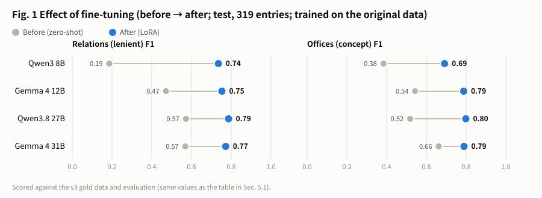
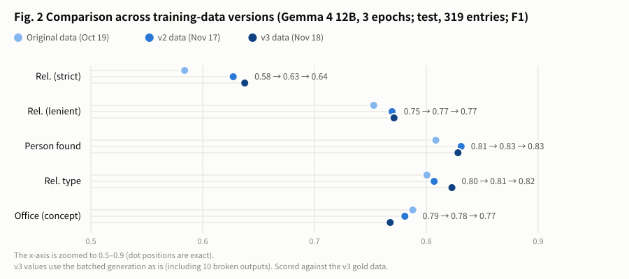
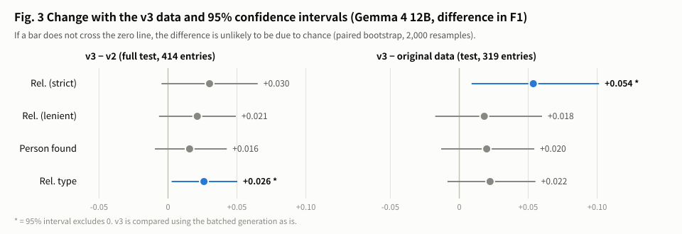
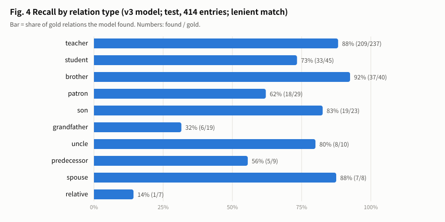

# Training a Model to Extract Relations and Offices from AINet-DB Biographies of *al-Ḍawʾ al-Lāmiʿ*: Overview

*Revised 21 November 2026 (reflects the results of training on the v3 data)* · [日本語版](TRAINING_OVERVIEW.md)

### Current status at a glance

| | Relations (lenient) F1 | Relations (strict) F1 | Offices (concept) F1 | Note |
|---|---|---|---|---|
| Before fine-tuning (Gemma 4 12B, zero-shot) | 0.47 | 0.34 | 0.54 | test, 319 entries |
| After fine-tuning, original data (Gemma 4 12B) | 0.75 | 0.58 | 0.79 | 〃 |
| **After fine-tuning, v3 data (Gemma 4 12B)** | **0.77** | **0.64** | 0.77 | 〃 |
| Reference: after fine-tuning, original data (Qwen3.8 27B, best) | 0.79 | 0.61 | 0.80 | 〃 |

All scores use the v3 gold data and evaluation method (Section 4).

- **Fine-tuning has a large effect**: relations (lenient) rose from 0.47 to 0.77, and offices (concept) from 0.54 to 0.77–0.79.
- **Effect of the data revisions (v2, v3)**: the model now writes names as they appear in the text, and relations (strict) rose from 0.58 to 0.64. This difference is statistically significant. The difference in relations (lenient) is within the margin of error.
- **Remaining issues**: low recall for grandfathers, other relatives, patrons and similar types (Fig. 4), and some outputs that break during batched generation (Section 5.3).

### Revision history

| Version | Date | Training data (`data/`) | Main changes |
|---|---|---|---|
| Original | 2026-10-19 | `processed/` | First version. Person names taken from the evidence phrase (`<desc>`) |
| v2 | 2026-11-17 | `processed_v2/` | Full revision following the error review of 11-16: latest XML and Rule 15, names cut out of the biography text, genealogical father excluded, persons matched by ID |
| **v3** | **2026-11-18** | **`processed_v3/`** | **More accurate name extraction** (Section 2.2). The name changed for about 400 of the 5,166 relations (8%) |

> **Key points of the v3 revision (2026-11-18)**
> We reduced the errors that remained in v2's automatic name extraction (only "بابن" extracted, names cut off midway, titles taken as names, etc.).
> - A person's name is first searched for **within the span of the evidence phrase**. Only when that span is not found in the text is the whole text searched, and then with stricter matching.
> - For persons without an ID (`#NEEDID`), the evidence phrase is used as a name only if it consists **solely of words used in personal names**. Titles and phrases such as "كاتب السر" (head of the chancery) or "جماعة" (a group) are set to no name (`null`) and excluded from evaluation.
> - The training settings are the same as for v2 (Gemma 4 12B, 3 epochs).
>
> **Key points of the v2 revision (2026-11-17)**
> Following the review of errors made by gemma-4-12b-it ep4 (2026-11-16), we revised how the training data and the evaluation are built.
> - The gold data was rebuilt from the latest XML (main, 2026-11-17). Relation directions are read according to the unified Rule 15.
> - Person names are no longer taken from the XML's evidence phrase (`<desc>`). Using the person ID as a clue, we cut out **the form of the name as written in the text**.
> - The **genealogical father** was removed from what the LLM extracts. The application generates this father by rule.
> - In evaluation, persons are matched **by ID**. Persons whose name does not appear in the text are excluded from evaluation.
> - Offices are waiting for the ID mapping table to be cleaned up. Their gold data is still built the old way, from the latest XML.

## 1. What we are doing

The AINet-DB project works on the biographical dictionary *al-Ḍawʾ al-Lāmiʿ* by al-Sakhāwī (d. 902 H / 1497 CE). It structures the biographical entries as TEI XML by combining extraction with generative AI and review by specialists.

In this work, we **fine-tune mid-sized language models that run locally (8–31 billion parameters), using the reviewed XML as gold data**, so that they extract the following information from the Arabic biography text:

- **Relations**: kinship (brother, son, etc.), academic relations (teacher, student, etc.) and social relations (patron, successor, etc.), together with the name of the other person
- **Offices**: the offices held by the subject of the entry

We have two aims:

1. To draft unprocessed entries on our own computer, without relying on external commercial APIs
2. To teach the model the review know-how the project has accumulated (which statements count as which relation)

The overall workflow is as follows.

```
 Reviewed TEI XML (4,195 persons)       Person register
   │  text · relation · state                │  person ID → names
   └──────────────┬──────────────────────────┘
                  ▼
        ① Build training data (build_dataset.py)
           text → {"relations": [...], "offices": [...]}
                  │  split 8:1:1 by person ID
       ┌──────────┼──────────────┐
       ▼          ▼              ▼
   train 3,330   val 451       test 414
       │          │              │
       ▼          ▼              │
  ② LoRA training ── pick best checkpoint
       (finetune.py)              │
                  │              │
                  ▼              ▼
        ③ Evaluate on test (evaluate.py) ── base model evaluated the same way
           precision / recall / F1 for relations and offices
```

## 2. Data

### 2.1 Source data

<!-- Internal resources; hidden in the public version
- Per-person XML files from the AINet-DB repository (GitHub: `wkmisr/AINet-DB-Sakhawi`, main as of 2026-11-17): **4,195 files** (3,978 of them reviewed)
- As auxiliary resources for looking up names from person IDs: **ID-Master** and **Sakhawi_PersonList** (both Google Sheets of the project, retrieved 2026-11-17)
-->
- Per-person XML files of the AINet-DB project: **4,195 files** (3,978 of them reviewed; as of 2026-11-17)
- As an auxiliary resource, the project's internal person register for looking up names from person IDs (retrieved 2026-11-17)

### 2.2 How the training data is built

From each XML file we extract the following and turn it into an input → output pair.

| | Content | Source in the XML |
|---|---|---|
| Input | Biography text | `note[@type='source']` |
| Output: relations | Relation type, group and the other person's name | `relation` elements (names taken from the text; see below) |
| Output: offices | Office name (Arabic) | `label` of `state[@type='office']` |

The main processing steps are as follows.

- **Relation type**: in the XML, `subtype` states "what the active party is to the passive party" (revision of Rule 15, 2026-11-16).
  - If the subject is passive, `subtype` is directly the other person's role. For example, `teacher` from a teacher (active) to the subject (passive) means "the other person is the subject's teacher".
  - If the subject is active, we use the inverse relation: `teacher` → `student` (the other person is the subject's student), `educator` → `ward` (the other person was raised by the subject).
  - Variant `subtype` values (e.g. `child` / `son`, `employer` / `patron`) were unified into 36 types, each assigned to one of three groups: `kinship`, `academic` or `social`.
- **The other person's name**: the evidence phrase (`<desc>`) can be a sentence fragment, so we do not use it as the name.
  1. From the other person's ID (`active` / `passive`), we collect that person's names: from the person register<!-- ID-Master, Sakhawi_PersonList --> and from the names in that person's own XML (full name, laqab, nisba, etc.).
  2. We search the text for the place where the most words of those names appear in sequence, and use **that form as written in the text** as the name. Prepositions and the conjunction و ("and") are dropped. Example: "وسمع على الشرف ابن الكويك" → `الشرف ابن الكويك`.
     - **Search range (v3)**: if the evidence phrase appears verbatim in the text, we search within that span first (2,184 cases). If the name is not found there, we search the whole text (111 cases; these are error-prone, so we record them separately). If the evidence phrase does not appear in the text, we search the whole text with stricter matching (1,573 cases).
  3. Al-Sakhāwī himself (in the text "منّي", "عليّ", etc.) is normalized to "السخاوي". Ibn Ḥajar often appears as "شيخنا", following the text.
  4. Persons whose name cannot be found in the text get their name from the ID instead. These are excluded from evaluation (Section 4).
  5. For persons without an ID (`#NEEDID`), the evidence phrase is used as a name only if it meets all of the following conditions (v3):
     - it appears verbatim in the text
     - it has at most 5 words
     - it consists only of words used in personal names (collected from the person register<!-- ID-Master, Sakhawi_PersonList --> and the names in the XML files)
     - it does not begin with a title (القاضي, كاتب, etc.)

     Kin references such as "ولده" (his son) and titles or phrases such as "كاتب السر" (head of the chancery) or "جماعة" (a group) are set to `null` (no name). Relations without a name are used for training and excluded from evaluation.

  Examples of differences between v2 and v3 (v2 → v3):

  | Error type | Name in v2 | Name in v3 |
  |---|---|---|
  | Only part of the name extracted | `بابن` | `ابن شيخنا` (name from the ID) |
  | Name cut off midway | `محمد بن عبد الله بن عبد` | `محمد بن عبد الله` |
  | Words picked up from the wrong place | `بابن الفقيه` | `محمد الفارسكوري` |
  | Title taken as a name | `كاتب السر` | `null` (no name) |
- **Excluding the genealogical father**: the application generates by rule the father who follows "بن" in the genealogy of the entry heading (name_only) (decision of 2026-11-16). We therefore removed this father from the gold data (1,808 cases). The instructions also tell the model not to output a father known only from the genealogy. Fathers named separately in the text (e.g. the father in an entry with a single name) are kept.
- **Other exclusions**: notes on identification (`possible_identity`), `subtype` values outside the controlled vocabulary (77 cases), relations where the subject is active and no inverse term exists (1 `killer`), and duplicates

The final size of the data is as follows (v3, with v2 for comparison).

| Item | v3 | v2 |
|---|---|---|
| Entries | 4,195 | 4,195 |
| Relations | 5,166 (kinship 1,806 / academic 2,589 / social 771) | 5,175 |
| of which the name appears in the text (evaluated) | **4,686** (form in the text 3,868, al-Sakhāwī himself 706, persons without ID 112) | 4,840 |
| of which the name does not appear in the text (not evaluated) | 480 (name from the ID 352, non-name phrase 98, etc.) | 335 |
| Offices | 2,204 | 2,204 |
| Entries without relations / without offices | 1,654 / 2,582 | same |
| Text length (characters) | median 139, top 10% at least 287, longest 4,257 | same |

Because v3 judges names in the text more strictly, it has 154 fewer evaluated relations than v2.

Relation types are very unevenly distributed. The most frequent are `teacher` 2,148, `brother` 568, `student` 383, `patron` 383, `son` 335 and `grandfather` 221. Because the genealogical father was removed, only 56 `father` relations remain. Types such as `servant` and `ward` occur only a few times.

### 2.3 Split into training, validation and test sets

Entries are split mechanically (by hash of the person ID) at about 8:1:1. No person appears in more than one set. The split is the same as before, so the 319 entries that were in the earlier test set are also in the current test set.

| Split | Entries | Use |
|---|---|---|
| train | 3,330 | Training |
| val | 451 | Monitoring during training and choosing the best checkpoint |
| test | 414 | Final evaluation only (never used for training or tuning) |

### 2.4 Format of the training data

The training data are JSON Lines files (one entry per line). There is one file per split: `sft_train.jsonl`, `sft_val.jsonl` and `sft_test.jsonl` (v3 in `data/processed_v3/`, v2 in `data/processed_v2/`). Each line holds a chat-style conversation with three messages.

```json
{
  "id": "AIND-D02212",
  "messages": [
    {"role": "system",    "content": "You extract structured data from biographical entries of al-Sakhāwī's ..."},
    {"role": "user",      "content": "بلاط بن عبد الله القجماسي سيف الدين أمير مجلس ، ..."},
    {"role": "assistant", "content": "{\"relations\": [...], \"offices\": [...]}"}
  ]
}
```

| Message | Content |
|---|---|
| `system` | Instructions (in English), the same for all entries. They give the output format, the list of 36 allowed relation types, and tell the model to write names as in the text and not to output the genealogical father |
| `user` | The biography text, taken from the XML as is, with only whitespace normalized |
| `assistant` | The gold JSON. The model is trained to output this |

The `assistant` JSON consists of two lists.

| List | Field | Content |
|---|---|---|
| `relations` | `type` | What the other person is to the subject (one of 36 types, e.g. `teacher`, `brother`, `patron`) |
| | `group` | One of `kinship`, `academic` or `social` |
| | `person` | The other person's name (as written in the text). Al-Sakhāwī himself is `"السخاوي"`; persons without a known name are `null` |
| `offices` | `office` | An office held by the subject (Arabic) |

If there are no relations or no offices, the list is empty (`[]`).

During training, `system` and `user` are given as input, and the loss is computed only on the `assistant` part (see Section 3).

We also build an intermediate file, `records.jsonl`. It is not used for training but is used for evaluation. For each entry it holds, in addition to the gold data:

- IDs from the source XML (person IDs of the other parties in relations; Wikidata / TMP-O IDs of offices)
- **Name aliases** for each relation (the form in the text, and names from the person register<!-- ID-Master, Sakhawi_PersonList --> and the person's own XML), used to match persons by ID in evaluation
- For each relation, whether the name appears in the text (if not, it is excluded from evaluation) and where the name came from
- The genealogical father from the entry heading (used so that a genealogical father output by the model is not counted)
- Whether the entry has been reviewed, and which split it belongs to

### 2.5 Example input and output (a test entry)

**Input (text)** — AIND-D02212
> بلاط بن عبد الله القجماسي سيف الدين أمير مجلس ، سمع على الغماري في سنة اثنتين وثمانمائة بعض البخاري وأثبت البقاعي اسمه في شيوخه . مات في .

**Gold**
```json
{"relations": [
   {"type": "teacher", "group": "academic", "person": "الغماري"},
   {"type": "student", "group": "academic", "person": "البقاعي"}],
 "offices": [{"office": "أمير مجلس"}]}
```

**Output of the fine-tuned model (Gemma 4 12B, trained on the original data)**
```json
{"relations": [
   {"type": "teacher", "group": "academic", "person": "الغماري"},
   {"type": "teacher", "group": "academic", "person": "البقاعي"}],
 "offices": [{"office": "أمير مجلس"}]}
```

Here the office and the teacher (الغماري) are correct. However, the model read the statement "al-Biqāʿī recorded his name among his own teachers" in the wrong direction (al-Biqāʿī as the subject's teacher). Confusing the direction of a relation like this is one of the typical errors.

**Output of the fine-tuned model (Gemma 4 12B, trained on the v3 data)**
```json
{"relations": [
   {"type": "teacher", "group": "academic", "person": "الغماري"}],
 "offices": [{"office": "أمير مجلس"}]}
```

The v3 model no longer outputs al-Biqāʿī as a teacher in the wrong direction. However, it does not extract him as a student either (a missed relation).

With every text, the model receives a short instruction (in English) describing the output format and the list of relation types.

More examples are in [data/sample/](data/sample/): 20 training entries, and for 20 test entries the gold data alongside the outputs before and after fine-tuning ([test_extractions.md](data/sample/test_extractions.md), in Japanese).

## 3. Training method

| Item | Setting |
|---|---|
| Base models | **Gemma 4 12B-it / 31B-it** (Google), **Qwen3 8B / Qwen3.8 27B** (Alibaba). All are open models |
| Method | **LoRA** (the base model is frozen and only small additional parameters are trained, about 0.5% of the total) |
| Loss | Only on the output (JSON). The instructions and text are not trained on |
| Main hyperparameters | 3 epochs, learning rate 2e-4 (cosine decay), effective batch size 16, LoRA rank 16 / alpha 32, maximum length 2,560 tokens |
| Checkpoint selection | Loss measured on val every 50 steps; the checkpoint with the lowest loss is used |
| Hardware | One workstation with an NVIDIA GB10 (approximate time for 3 epochs on the new data: Qwen3 8B about 8 h, Gemma 4 12B about 16 h (measured for v3), Qwen3.8 27B about 25 h, Gemma 4 31B about 32 h) |

For each model, we run "evaluation before training (baseline) → training → evaluation after training" in the same way. The baseline evaluation uses the same instructions (zero-shot, with no examples).

For Gemma 4 12B, we also tried training for 4 epochs. The results were almost the same as with 3 epochs.

So far, only Gemma 4 12B (3 epochs) has been trained on the v2 and v3 data. Training on v3 took about 16 hours (627 steps). The best checkpoint was the final step, with a val loss of 0.145. The value for v2 was 0.123, but the losses cannot be compared because v2 and v3 have different gold data in val.

## 4. Evaluation method

We compare the model's output with the gold data for the 414 test entries. In the v3 gold data there are 546 relations, of which the 479 whose name appears in the text are evaluated (498 of 547 in the v2 gold data). There are 216 offices.

When comparing with models trained on the original data, we restrict the test set to the 319 entries that were also in the original test set (367 evaluated relations). All scoring was redone with the **v3 gold data** (`runs/rescore_v3/`). Values may therefore differ slightly from earlier versions of this document.

- **Precision**: the share of the model's outputs that are correct
- **Recall**: the share of the gold items that the model found
- **F1**: the harmonic mean of the two. Most values in the tables are F1

Before matching, we normalize Arabic spelling variants (alif with hamza, tāʾ marbūṭa, vowel marks, etc.). For names, we also drop a leading conjunction و ("and"; e.g. والشمس → الشمس). We then count from the following points of view.

| Metric | What it measures |
|---|---|
| Relations (strict) `rel_strict` | Same type, and the name matches the gold form (form in the text) exactly |
| Relations (lenient) `rel_lenient` | Same type, and the name loosely matches **any alias** of the gold person (one contained in the other; e.g. سليمان ≈ سليمان بن عيسى) |
| Person found `rel_person` | The name matches (by the same criterion as above), regardless of type |
| Relation type `rel_type` | The number of relations of each type matches, regardless of name |
| Offices (string) `office` | The office name matches as a string |
| Offices (concept) `office_concept` | Office names are mapped to the IDs in the gold data (Wikidata / TMP-O) before matching (e.g. قاض and قضاء حلب count as the same concept) |

**Matching persons by ID (since 2026-11-17)**: each gold relation carries a list of names linked to the other person's ID (the form in the text, and names from the person register<!-- ID-Master, Sakhawi_PersonList --> and the person's own XML). If the name output by the model matches any of them, it is treated as the same person. So a mismatch that is only "full name in the gold data, short name from the text in the output" is not counted as an error. Exact matches are paired first and loose matches afterwards, so that a loose match cannot claim the wrong person first.

**Excluded from evaluation**
- Gold persons whose name does not appear in the text. Model outputs that refer to such persons are not counted either.
- Genealogical fathers output by the model (those matching the father in the heading genealogy). They are removed from the gold data because the application adds them by rule.

The way names and office titles are written varies even within the gold data (for example, how much of a name is written). For practical purposes, we therefore consider the "lenient" and "concept" metrics more appropriate.

## 5. Results (test, F1)

All values in this section were rescored with the v3 gold data. The figures are generated from `runs/rescore_v3/` by `scripts/analysis/make_figures.py` (`figures/`).

### 5.1 Effect of fine-tuning (4 models, trained on the original data)

For the 4 models trained on the original data, we compared the model before fine-tuning (zero-shot) and after. The test set is the 319 entries.



| Metric | Qwen3 8B | Gemma 4 12B | Qwen3.8 27B | Gemma 4 31B |
|---|---|---|---|---|
| Relations (strict) | 0.13 → 0.57 | 0.34 → 0.58 | 0.46 → **0.61** | 0.46 → 0.59 |
| Relations (lenient) | 0.19 → 0.74 | 0.47 → 0.75 | 0.57 → **0.79** | 0.57 → 0.77 |
| Person found | 0.36 → 0.78 | 0.65 → 0.81 | 0.66 → **0.84** | 0.70 → 0.82 |
| Relation type | 0.24 → 0.80 | 0.53 → 0.80 | 0.64 → **0.82** | 0.64 → 0.81 |
| Offices (concept) | 0.38 → 0.69 | 0.54 → 0.79 | 0.52 → **0.80** | 0.66 → 0.79 |
| Exact match of the whole output | 4% → 46% | 25% → 48% | 36% → 47% | 26% → **53%** |

(Each cell: before → after. Bold marks the best value after fine-tuning.)

- **Fine-tuning improved every model substantially.** The gap before fine-tuning (0.19–0.57) narrows to 0.74–0.79 afterwards.
- The best model after fine-tuning is Qwen3.8 27B. However, it is only about 0.03 ahead of Gemma 4 12B, which needs about half the compute time.
- Compared with the old evaluation (Section 5.4), correcting the evaluation alone raised relations (lenient) by 0.06–0.09 for every model. Many of the outputs counted as "errors" in the old evaluation were caused by the gold data and the evaluation.

### 5.2 Effect of revising the training data (Gemma 4 12B)

With the same Gemma 4 12B and the same settings (3 epochs), we changed only the version of the training data. To match the conditions of the models trained on the original data, we compare on the 319 test entries.



| Metric | Original data, 3 epochs | Original data, 4 epochs | v2 data | **v3 data** | v3 data (broken outputs regenerated) |
|---|---|---|---|---|---|
| Relations (strict) | 0.58 | 0.57 | 0.63 | **0.64** | 0.64 |
| Relations (lenient) | 0.75 | 0.77 | 0.77 | **0.77** | 0.78 |
| Person found | 0.81 | 0.82 | 0.83 | **0.83** | 0.83 |
| Relation type | 0.80 | 0.83 | 0.81 | **0.82** | 0.83 |
| Offices (concept) | 0.79 | 0.77 | 0.78 | **0.77** | 0.77 |
| Exact match of the whole output | 48% | 49% | 51% | **50%** | 51% |
| Outputs readable as JSON | 100% | 99.4% | 98.1% | **96.9%** | 99.7% |
| Genealogical fathers output (excluded from evaluation) | 66 | 60 | 0 | **0** | 0 |
| Students (`student`) found | 28/42 | 34/42 | 29/42 | **30/42** | 30/42 |

The rightmost column regenerates the broken outputs one at a time (Section 5.3).

- **Name forms**: from v2 on, the model writes names as they appear in the text. Relations (strict) rose from 0.58 to 0.64, and this difference is significant (Fig. 3, right).
- **Genealogical father**: from v2 on, the models output no genealogical fathers at all. The model learned the convention set in the data exactly.
- **Relations (lenient) and offices**: the differences between data versions are 0.01–0.02, within the margin of error.
- **Students**: with v2 we reported that recall for students had dropped. That comparison was against the original-data model trained for 4 epochs. Compared with the 3-epoch model on the original data (28/42), v2 and v3 show no drop.



Fig. 3 shows the difference in F1 for the v3 model against two other models: on the left the v2 model (full test set), on the right the original-data model (319 entries).

- **v3 vs v2**: v3 scores 0.02–0.03 higher on every metric. However, only for "relation type" does the 95% interval exclude 0.
- **v3 vs the original data**: only the improvement in "relations (strict)" (+0.05) is significant.

### 5.3 Detailed results of the v3 model (full test set, 414 entries)

| Metric | v2 data | **v3 data** | v3 data (broken outputs regenerated) |
|---|---|---|---|
| Relations (strict) | 0.61 | **0.64** | 0.64 |
| Relations (lenient) | 0.75 | **0.77** | 0.77 |
| Person found | 0.81 | **0.83** | 0.83 |
| Relation type | 0.80 | **0.82** | 0.83 |
| Offices (string) | 0.50 | **0.49** | 0.50 |
| Offices (concept) | 0.77 | **0.77** | 0.78 |
| Exact match of the whole output | 50% | **50%** | 50% |
| Outputs readable as JSON | 98.3% | **96.6%** | 99.3% |

For relations (lenient), precision is 0.77 and recall 0.76: over-extraction and missed relations occur about equally often.

**Recall by relation type**



- **Types extracted well**: the frequent types teacher (88%), brother (92%) and son (83%).
- **Weak types**: grandfather (32%), other relative (14%), patron (62%), predecessor (56%).
- Most grandfathers appear only in the heading genealogy. Removing the genealogical father may have led the model to stop outputting genealogical relatives in general (Section 6).
- No in-law (`father-in-law` 0/6) or father (`father` 0/4) was found. Both types are very rare.

**Recall by source of the gold name (relations, lenient)**

| Source of the gold name | Count | Recall |
|---|---|---|
| Al-Sakhāwī himself (first-person statements) | 60 | 83% |
| Form in the text, found within the evidence phrase span | 217 | 78% |
| Form in the text, found in the whole text (no evidence phrase in the text) | 185 | 74% |
| Form in the text, found outside the evidence phrase span | 11 | 45% |

We think names found outside the span are likely to have been extracted wrongly on the gold side.

**Broken outputs (outputs not readable as JSON)**

The v3 model returned output not readable as JSON for 14 of the 414 entries.

| Type of breakage | Count | Result of regenerating one at a time |
|---|---|---|
| Output only `100%` | 10 | All 10 became valid JSON |
| Output only `.` | 2 | 0 (still broken) |
| Same name repeated up to the maximum length | 2 | 1 became valid |

- The evaluation generates outputs in batches of 16. Of the 14 broken outputs, 11 became valid when regenerated one at a time. Most of the breakage therefore seems to come from batched generation rather than from what the model learned.
- Regeneration changes relations (lenient) only from 0.768 to 0.772. Most of the affected entries were short, with 0–1 relations.

### 5.4 (Reference) Results with the original data and the old evaluation

| Metric | Qwen3 8B before | Qwen3 8B after | Gemma 4 12B before | Gemma 4 12B after |
|---|---|---|---|---|
| Relations (strict) | 0.12 | 0.48 | 0.28 | 0.50 |
| Relations (lenient) | 0.18 | 0.67 | 0.42 | 0.68 |
| Person found | 0.37 | 0.73 | 0.59 | 0.74 |
| Relation type | 0.24 | 0.76 | 0.53 | 0.78 |
| Offices (string) | 0.15 | 0.41 | 0.18 | 0.52 |
| Offices (concept) | 0.37 | 0.66 | 0.52 | 0.74 |
| Exact match of the whole output | 2% | 36% | 19% | 40% |
| Outputs readable as JSON | 98.8% | 100% | 99.7% | 100% |

## 6. Caveats and limitations

- **Nature of the gold data**: the gold data is XML produced by "generative-AI extraction + specialist review". Not every entry has necessarily been reviewed to the same standard (about 5% are unreviewed). The scores therefore measure "agreement with the project's existing data", not historical correctness as such.
- **Gold names are extracted automatically**: the forms in the text are found mechanically, using the names from the IDs as clues. Spot checks show they are mostly correct, but a few errors remain, such as:
  - extra words attached (e.g. "سكنا" in "الحسيني سكنا")
  - only part of the name extracted

  In v3 we improved the extraction and corrected about 400 names (Section 2.2). Even so, we expect many errors among the names found outside the evidence phrase span (111 cases). Because evaluation matches against all of a person's aliases, we think the effect on metrics other than strict matching is small.
- **Genealogical relatives other than the father**: grandfathers appearing in the heading genealogy (most of the 221 `grandfather` relations) are kept in the gold data for now. Like the father, they may be included inconsistently, and how to treat them is under discussion. The v3 model's recall for grandfathers is low at 32% (Fig. 4), which may be affected by this.
- **Offices**: we are waiting for the office ID mapping table to be cleaned up. Once it is, we will rebuild the office gold data and the training data.
- **Size of the evaluation**: the test set has 414 entries. Scores for rare relation types may vary widely. Each setting was also trained only once, so random variation has not been assessed. Most differences of 0.01–0.03 between models or data versions are within the margin of error (Fig. 3).
- **Broken outputs in batched generation**: generating in batches of 16 breaks the output for some entries (Section 5.3). Practical use requires detecting broken outputs and regenerating them one at a time.
- **Information not covered**: at this stage, information other than relations and offices (dates of birth and death, places, works, etc.) is out of scope.

## 7. Next steps

1. ~~Train and evaluate Gemma 4 12B on the new data~~ (v2 completed 11-18, v3 completed 11-19). Next, we will **train Qwen3.8 27B on the v3 data** (about 25 hours). After that, we will compile a list of the biographies with remaining errors for the v3 model (`analysis/`) and ask for them to be checked
2. Improve generation in the evaluation, so that broken outputs are automatically regenerated one at a time
3. Once we receive the office ID mapping table, rebuild the office gold data and training data, and retrain
4. Address the model's own weaknesses among the remaining errors: kinship and in-laws (low recall for grandfathers and in-laws), non-relations, long enumerations, first-person statements, and offices expressed with verbs. We plan to add training examples and similar measures
5. Apply the model to actual unprocessed entries and measure how much it reduces the reviewers' workload
