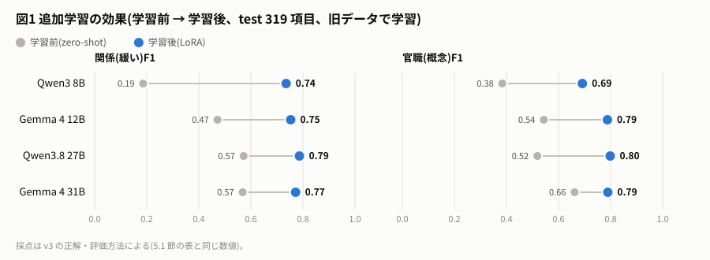
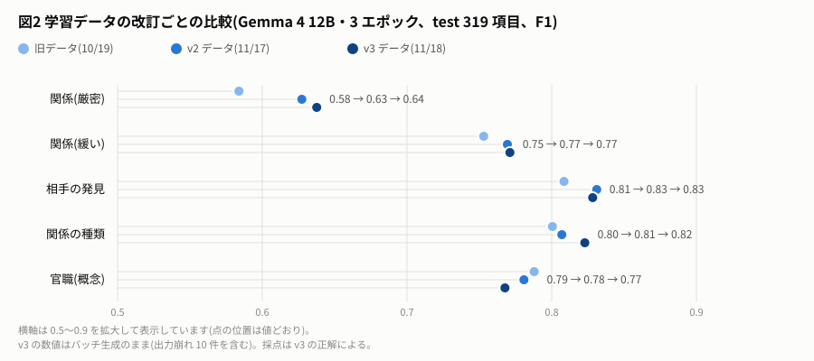
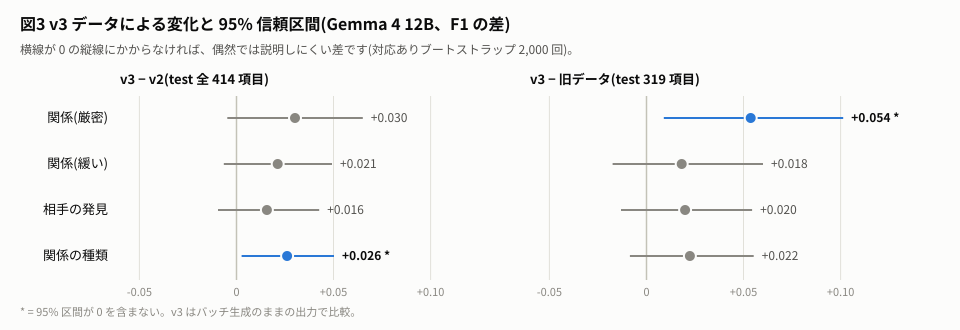
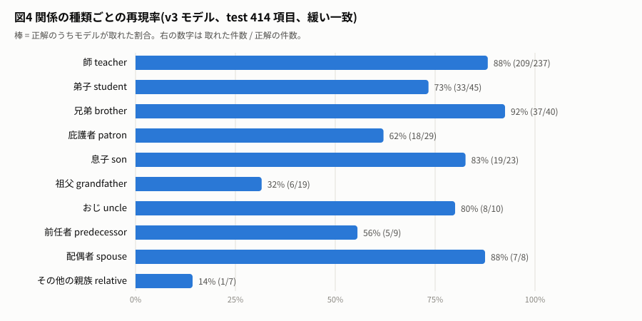

# AINet-DB『輝く光』伝記からの関係・官職抽出モデルの学習 — 概要

*2026年11月21日改訂(v3 データでの学習結果を反映)*

### ひと目でわかる現状

| | 関係(緩い)F1 | 関係(厳密)F1 | 官職(概念)F1 | 備考 |
|---|---|---|---|---|
| 学習前(Gemma 4 12B、zero-shot) | 0.47 | 0.34 | 0.54 | test 319 項目 |
| 学習後・旧データ(Gemma 4 12B) | 0.75 | 0.58 | 0.79 | 〃 |
| **学習後・v3 データ(Gemma 4 12B)** | **0.77** | **0.64** | 0.77 | 〃 |
| 参考: 学習後・旧データ(Qwen3.8 27B、最良) | 0.79 | 0.61 | 0.80 | 〃 |

採点はすべて v3 の正解・評価方法によります(4 章)。

- **追加学習の効果は大きい**: 関係(緩い)は 0.47 → 0.77、官職(概念)は 0.54 → 0.77〜0.79 に上がりました。
- **データの改訂(v2・v3)の効果**: 人名を本文どおりに書けるようになり、関係(厳密)が 0.58 → 0.64 に上がりました。この差は統計的にも有意です。一方、関係(緩い)の差は誤差の範囲です。
- **残る課題**: 祖父・その他の親族・庇護者などの再現率が低いこと(図4)、バッチ生成で出力が崩れる例があること(5.3 節)。

### 改訂の履歴

| 版 | 日付 | 学習データ(`data/`) | 主な変更 |
|---|---|---|---|
| 旧 | 2026-10-19 | `processed/` | 最初の版。人名は根拠の語句(`<desc>`)から取る |
| v2 | 2026-11-17 | `processed_v2/` | ふりかえり(11-16)を受けた全面改訂。最新 XML・規則15、人名を本文の表記から切り出す、系譜の父を除外、人物を ID 単位で照合 |
| **v3** | **2026-11-18** | **`processed_v3/`** | **人名の切り出しの精度改善**(2.2 節)。関係 5,166 件のうち約 400 件(8%)の人名が変わった |

> **v3 での改訂(2026-11-18)の要点**
> v2 の人名の自動切り出しに残っていた誤り(「بابن」だけ、名前の途中で切れる、肩書きを名前とする等)を減らしました。
> - 相手の名前は、まず**根拠の語句の範囲の中**で探します。範囲が本文に見つからないときだけ本文全体を探し、そのときは照合を厳しくします。
> - ID のない相手(`#NEEDID`)は、根拠の語句が**人名に使われる語だけ**でできているときに限り、名前として使います。「كاتب السر」(書記長)や「جماعة」(一団)のような肩書き・語句は名前なし(`null`)にし、評価からも外します。
> - 学習の設定は v2 と同じです(Gemma 4 12B、3 エポック)。
>
> **v2 での改訂(2026-11-17)の要点**
> gemma-4-12b-it ep4 の誤りのふりかえり(2026-11-16)を受けて、学習データと評価の作り方を改めました。
> - 正解データは最新の XML(main、2026-11-17)から作り直しました。関係の向きは、統一後の規則15 にしたがって読みます。
> - 人名は、XML の「根拠の語句」(`<desc>`)からは取りません。人物 ID を手がかりに、**本文中の表記**を切り出します。
> - **系譜の父**は LLM の抽出対象から外しました。この父はアプリが規則で生成します。
> - 評価では、人物を **ID 単位**で照合します。本文に名前の現れない人物は評価から外します。
> - 官職は、ID 対応表の整理を待っている段階です。正解は従来の作り方のまま、最新の XML から取っています。

## 1. 何をしているか

アル＝サハーウィー(al-Sakhāwī, 902 H / 1497 CE 没)の人物録『輝く光(*al-Ḍawʾ al-Lāmiʿ*)』を対象とする AINet-DB プロジェクトでは、生成 AI による抽出と専門家の校閲を組み合わせて、伝記エントリを TEI XML に構造化しています。

本取り組みでは、その **校閲済み XML を正解データとして、ローカルで動く中規模の言語モデル(80〜310 億パラメータ)を追加学習(ファインチューニング)** し、伝記本文(アラビア語)から次の情報を抽出させます。

- **人間関係**: 親族(兄弟・息子など)、学問上の関係(師・弟子など)、社会的関係(庇護者・後任など)と、その相手の人名
- **官職**: 本人が就いた官職名

ねらいは次の 2 点です。

1. 未処理エントリの下書き作成を、外部の商用 API に頼らず手元の計算機で行えるようにする
2. プロジェクトがこれまで蓄積した校閲の知見(どの記述をどの関係として取るか)をモデルに覚えさせる

全体の流れは次のとおりです。

```
 校閲済み TEI XML (4,195 人)          人物名簿
   │  本文・relation・state                │  人物 ID → 名前
   └──────────────┬─────────────────────────┘
                  ▼
        ① 学習データの作成 (build_dataset.py)
           本文 → {"relations": [...], "offices": [...]}
                  │  人物 ID で 8:1:1 に分割
       ┌──────────┼──────────────┐
       ▼          ▼              ▼
   train 3,330   val 451       test 414
       │          │              │
       ▼          ▼              │
  ② LoRA 学習 ── 最良時点の選択    │
       (finetune.py)              │
                  │              │
                  ▼              ▼
        ③ test で評価 (evaluate.py) ── 学習前のモデルも同じ手順で評価
           関係・官職ごとに適合率/再現率/F1
```

## 2. データ

### 2.1 元データ

<!-- 内部資料のため公開版では非表示
- AINet-DB リポジトリ(GitHub: `wkmisr/AINet-DB-Sakhawi`、main 2026-11-17 時点)の、人物ごとの XML ファイル **4,195 件**(うち校閲済み 3,978 件)
- 補助として、人物 ID から人名を引くための **ID-Master** と **Sakhawi_PersonList**(いずれもプロジェクトの Google スプレッドシート、2026-11-17 取得)
-->
- AINet-DB プロジェクトの人物ごとの XML ファイル **4,195 件**(うち校閲済み 3,978 件、2026-11-17 時点)
- 補助として、人物 ID から人名を引くためのプロジェクト内部の人物名簿(2026-11-17 取得)

### 2.2 学習データの作り方

各 XML から次のものを取り出し、「入力 → 出力」の組にします。

| | 中身 | XML 上の出どころ |
|---|---|---|
| 入力 | 伝記本文 | `note[@type='source']` |
| 出力: 関係 | 関係の種類・分類・相手の人名 | `relation` 要素(人名は本文から。下記) |
| 出力: 官職 | 官職名(アラビア語) | `state[@type='office']` の `label` |

主な処理は以下のとおりです。

- **関係の種類**: XML の `subtype` は「active が passive の何にあたるか」を表します(規則15 の改訂、2026-11-16)。
  - 本人が passive なら、`subtype` がそのまま相手の役割です。例えば、師(active)→ 本人(passive)の `teacher` は「相手が本人の師」です。
  - 本人が active なら、逆の関係にします。`teacher` → `student`(相手が本人の弟子)、`educator` → `ward`(相手が本人に養育された者)です。
  - 表記揺れのある `subtype`(例: `child` / `son`、`employer` / `patron`)は 36 種類に統一し、`kinship`(親族)/ `academic`(学問)/ `social`(社会)の 3 分類を付けました。
- **相手の人名**: 根拠の語句(`<desc>`)は文の断片であることがあるので、人名としては使いません。
  1. 相手の人物 ID(`active` / `passive`)から、その人物の名前を集めます。集める先は、人物名簿<!-- ID-Master、人物一覧 -->、その人物自身の XML の名前(フルネーム・ラカブ・ニスバなど)です。
  2. 本文の中から、それらの名前の語が最も多く連続する箇所を探し、**本文どおりの表記**を人名とします。前置詞や接続の و(「と」)は外します。例: 「وسمع على الشرف ابن الكويك」→ `الشرف ابن الكويك`。
     - **探す範囲(v3)**: 根拠の語句が本文にそのまま現れるときは、まずその範囲の中を探します(2,184 件)。見つからなければ本文全体を探します(111 件。誤りやすいので記録して区別しています)。根拠の語句が本文に現れないときは本文全体を探し、そのときは照合を厳しくします(1,573 件)。
  3. サハーウィー本人(本文では「منّي」「عليّ」など)は「السخاوي」に統一しています。イブン・ハジャルは、本文の表記どおり「شيخنا」になることが多くなります。
  4. 本文に表記が見つからない人物は、ID の名前で代用します。評価ではこれを除外します(4 章)。
  5. ID のない相手(`#NEEDID`)は、根拠の語句が次の条件をすべて満たすときだけ、名前として使います(v3)。
     - 本文にそのまま現れる
     - 5 語以内である
     - 人名に使われる語(人物名簿<!-- ID-Master・人物一覧 -->・XML の名前から集めた語)だけでできている
     - 肩書き(القاضي、كاتب など)で始まらない

     「ولده」(彼の息子)のような呼び方や、「كاتب السر」(書記長)、「جماعة」(一団)のような肩書き・語句は `null`(名前なし)にします。名前なしの関係は学習には使い、評価からは外します。

  v2 と v3 の違いの例(v2 → v3):

  | 誤りの種類 | v2 の人名 | v3 の人名 |
  |---|---|---|
  | 名前の一部しか取れていない | `بابن` | `ابن شيخنا`(ID の名前で代用) |
  | 名前の途中で切れている | `محمد بن عبد الله بن عبد` | `محمد بن عبد الله` |
  | 別の箇所の語を拾っている | `بابن الفقيه` | `محمد الفارسكوري` |
  | 肩書きを名前としている | `كاتب السر` | `null`(名前なし) |
- **系譜の父の除外**: 見出しの系譜(name_only)で「بن」の次に来る父は、アプリが規則で生成します(2026-11-16 裁定)。そのため、この父は正解から除きました(1,808 件)。指示文でも「系譜からしか分からない父は出さない」と伝えています。本文に別途名指しされる父(単名の項の父など)は残しています。
- **除外したもの**: 同定に関するメモ(`possible_identity`)、統制語彙外の `subtype`(77 件)、逆の語のない本人 active の関係(`killer` 1 件)、重複

最終的な規模は次のとおりです(v3。括弧内は v2)。

| 項目 | v3 の件数 | v2 の件数 |
|---|---|---|
| エントリ数 | 4,195 | 4,195 |
| 関係 | 5,166(親族 1,806 / 学問 2,589 / 社会 771) | 5,175 |
| うち人名が本文に現れるもの(評価対象) | **4,686**(本文の表記 3,868、サハーウィー本人 706、ID なしの相手 112) | 4,840 |
| うち人名が本文に現れないもの(評価対象外) | 480(ID の名前で代用 352、名前でない語句 98 など) | 335 |
| 官職 | 2,204 | 2,204 |
| 関係のないエントリ / 官職のないエントリ | 1,654 / 2,582 | 同じ |
| 本文の長さ(文字数) | 中央値 139、上位 10% は 287 以上、最長 4,257 | 同じ |

v3 では本文中の名前の判定を厳しくしたため、評価対象の関係は v2 より 154 件少なくなっています。

関係の種類には大きな偏りがあります。多い順に `teacher` 2,148、`brother` 568、`student` 383、`patron` 383、`son` 335、`grandfather` 221 です。系譜の父を除いたため、`father` は 56 件しか残っていません。`servant` や `ward` などは数件しかありません。

### 2.3 学習・検証・評価への分割

人物 ID から機械的に(ハッシュ値で)約 8:1:1 に分けています。同じ人物が複数の組に入ることはありません。分け方は前回と同じなので、前回 test だった 319 件は今回も test に入ります。

| 分割 | 件数 | 用途 |
|---|---|---|
| train | 3,330 | 学習 |
| val | 451 | 学習中の確認と、最良時点の選択 |
| test | 414 | 最終評価のみ(学習・調整には使わない) |

### 2.4 学習データの形式

学習データは JSON Lines 形式のファイルです(1 行に 1 エントリ)。分割ごとに `sft_train.jsonl`、`sft_val.jsonl`、`sft_test.jsonl` の 3 つがあります(v3 は `data/processed_v3/`、v2 は `data/processed_v2/`)。各行には、3 つの発話からなるチャット形式の会話が入っています。

```json
{
  "id": "AIND-D02212",
  "messages": [
    {"role": "system",    "content": "You extract structured data from biographical entries of al-Sakhāwī's ..."},
    {"role": "user",      "content": "بلاط بن عبد الله القجماسي سيف الدين أمير مجلس ، ..."},
    {"role": "assistant", "content": "{\"relations\": [...], \"offices\": [...]}"}
  ]
}
```

| 発話 | 中身 |
|---|---|
| `system` | 指示文(英語)。全エントリで共通です。出力形式、使ってよい関係の種類 36 個の一覧、人名は本文の表記で書くこと、系譜の父は出さないことを示しています |
| `user` | 伝記本文。XML の本文から、空白だけ整えてそのまま入れています |
| `assistant` | 正解の JSON。モデルはこれを出力するように学習します |

`assistant` の JSON は、次の 2 つのリストからなります。

| リスト | 各項目のフィールド | 内容 |
|---|---|---|
| `relations` | `type` | 相手が本人から見て何にあたるか(36 種類のどれか。例: `teacher`、`brother`、`patron`) |
| | `group` | `kinship`(親族)、`academic`(学問)、`social`(社会)のどれか |
| | `person` | 相手の人名(本文の表記)。サハーウィー本人は `"السخاوي"`、名前が分からない人物は `null` |
| `offices` | `office` | 本人が就いた官職名(アラビア語) |

関係や官職が 1 つもない場合、そのリストは空(`[]`)になります。

学習のときは、`system` と `user` を入力として与え、`assistant` の部分だけで損失を計算します(3 章参照)。

学習には使いませんが、別に中間ファイル `records.jsonl` も作っています。評価ではこれを使います。各エントリについて、正解に加えて次の情報を持たせています。

- 元 XML での ID(関係の相手の人物 ID、官職の Wikidata / TMP-O ID)
- 関係ごとの**人名の別名**(本文の表記、人物名簿<!-- ID-Master・人物一覧 -->・本人 XML の名前)。評価で人物を ID 単位で照合するのに使います
- 関係ごとに、人名が本文に現れるか(現れなければ評価から除外)、人名をどこから取ったか
- 見出しの系譜の父(評価で、モデルが出した系譜の父を数えないために使います)
- 校閲済みかどうか、どの分割に入るか

### 2.5 入出力の例(test のエントリ)

**入力(本文)** — AIND-D02212
> بلاط بن عبد الله القجماسي سيف الدين أمير مجلس ، سمع على الغماري في سنة اثنتين وثمانمائة بعض البخاري وأثبت البقاعي اسمه في شيوخه . مات في .

**正解**
```json
{"relations": [
   {"type": "teacher", "group": "academic", "person": "الغماري"},
   {"type": "student", "group": "academic", "person": "البقاعي"}],
 "offices": [{"office": "أمير مجلس"}]}
```

**学習後モデル(Gemma 4 12B、旧データで学習)の出力**
```json
{"relations": [
   {"type": "teacher", "group": "academic", "person": "الغماري"},
   {"type": "teacher", "group": "academic", "person": "البقاعي"}],
 "offices": [{"office": "أمير مجلس"}]}
```

この例では、官職と師(الغماري)は正しく取れています。一方、「البقاعي が彼の名を自分の師の一覧に載せた」という記述を、モデルは逆向き(البقاعي が本人の師)と解釈しました。このような関係の向きの取り違えは、典型的な誤りの一つです。

**学習後モデル(Gemma 4 12B、v3 データで学習)の出力**
```json
{"relations": [
   {"type": "teacher", "group": "academic", "person": "الغماري"}],
 "offices": [{"office": "أمير مجلس"}]}
```

v3 のモデルは、البقاعي を逆向きの師として出すことはなくなりました。ただし、弟子として取ることもできていません(取りこぼし)。

モデルには、出力形式と関係の種類の一覧を説明した短い指示文(英語)を、本文と一緒に毎回与えています。

## 3. 学習の方法

| 項目 | 設定 |
|---|---|
| ベースモデル | **Gemma 4 12B-it / 31B-it**(Google)、**Qwen3 8B / Qwen3.8 27B**(Alibaba)。いずれも公開モデル |
| 手法 | **LoRA**(モデル本体は固定し、小さな追加パラメータだけを学習。学習対象は全体の約 0.5%) |
| 損失の範囲 | 出力(JSON)の部分のみ。指示文と本文は学習の対象外 |
| 主なハイパーパラメータ | 3 エポック、学習率 2e-4(cosine 減衰)、実効バッチサイズ 16、LoRA rank 16 / alpha 32、最大長 2,560 トークン |
| モデルの選択 | 50 ステップごとに val で損失を測り、最も低い時点のものを採用 |
| 計算環境 | NVIDIA GB10 を搭載したワークステーション 1 台(新データ 3 エポックの目安: Qwen3 8B 約 8 時間、Gemma 4 12B 約 16 時間(v3 の実測)、Qwen3.8 27B 約 25 時間、Gemma 4 31B 約 32 時間) |

各モデルについて、「学習前(ベースライン)の評価 → 学習 → 学習後の評価」を同じ手順で実行しています。学習前の評価でも、同じ指示文を与えています(例は与えない zero-shot)。

Gemma 4 12B については、4 エポック学習した版も試しました。結果は 3 エポックとほぼ同じでした。

v2・v3 のデータでは、これまでのところ Gemma 4 12B(3 エポック)だけを学習しています。v3 の学習は約 16 時間かかりました(627 ステップ)。最良の時点は最終ステップで、val の損失は 0.145 でした。v2 は 0.123 でしたが、v2 と v3 では val の正解が違うので、損失の値は比べられません。

## 4. 評価の方法

test の 414 エントリについて、モデルの出力を正解と突き合わせます。v3 の正解では、関係は 546 件で、うち本文に名前の現れる 479 件が評価対象です(v2 の正解では 547 件中 498 件)。官職は 216 件です。

旧データで学習したモデルと比べるときは、旧データでも test だった 319 エントリに絞ります(評価対象の関係は 367 件)。採点はすべて **v3 の正解**で行い直しています(`runs/rescore_v3/`)。そのため、以前の版の本書と数値が少しずれることがあります。

- **適合率(Precision)**: モデルが出したもののうち、正しかった割合
- **再現率(Recall)**: 正解のうち、モデルが取れた割合
- **F1**: 上の 2 つの調和平均。表の数値は主にこれです

照合の前に、アラビア語の表記揺れを正規化しています(ハムザ付きアリフ、ター・マルブータ、母音記号など)。人名については、頭に付く接続の و(「と」。例: والشمس → الشمس)も落とします。そのうえで、次の観点ごとに数えます。

| 指標 | 何を見るか |
|---|---|
| 関係(厳密) `rel_strict` | 種類が一致し、人名が正解の表記(本文の表記)と完全に一致 |
| 関係(緩い) `rel_lenient` | 種類が一致し、人名が正解の人物の**別名のどれか**と緩く一致(一方が他方に含まれればよい。例: سليمان ≈ سليمان بن عيسى) |
| 相手の発見 `rel_person` | 種類を問わず、人名が(上と同じ基準で)一致 |
| 関係の種類 `rel_type` | 人名を問わず、関係の種類の個数が一致 |
| 官職(表記) `office` | 官職名の文字列が一致 |
| 官職(概念) `office_concept` | 官職名を、正解データの ID(Wikidata / TMP-O)に寄せてから照合(例: قاض と قضاء حلب は同じ概念とみなす) |

**人物の ID 単位の照合(2026-11-17 から)**: 正解の各関係には、相手の ID に結び付いた名前の一覧(本文の表記、人物名簿<!-- ID-Master・人物一覧 -->・本人 XML の名前)を持たせています。モデルが出した名前がそのどれかに一致すれば、同じ人物とみなします。このため、正解が正式名でモデルが本文の呼び名、というだけの食い違いは誤りに数えません。対応付けは、完全一致を先に、緩い一致を後に行います。こうして、緩い一致で別の人物に先取りされるのを防いでいます。

**評価から外すもの**
- 正解のうち、人名が本文に現れない人物。モデルの出力のうち、その人物に当たるものも数えません。
- モデルが出した系譜の父(見出しの系譜の父と一致するもの)。正解からは除いてあり、アプリが規則で補うものだからです。

人名や官職名の書き方は、正解データの中でも揺れています(例えば名前をどこまで長く書くか)。そのため、実用上の目安には「緩い」「概念」の指標の方が適していると考えています。

## 5. 結果(test、F1)

この章の数値は、すべて v3 の正解で採点し直したものです。図は `scripts/analysis/make_figures.py` で `runs/rescore_v3/` から作っています(`figures/`)。

### 5.1 追加学習の効果(4 モデル、旧データで学習)

旧データで学習した 4 モデルについて、学習前(zero-shot)と学習後を比べました。対象は test 319 エントリです。



| 指標 | Qwen3 8B | Gemma 4 12B | Qwen3.8 27B | Gemma 4 31B |
|---|---|---|---|---|
| 関係(厳密) | 0.13 → 0.57 | 0.34 → 0.58 | 0.46 → **0.61** | 0.46 → 0.59 |
| 関係(緩い) | 0.19 → 0.74 | 0.47 → 0.75 | 0.57 → **0.79** | 0.57 → 0.77 |
| 相手の発見 | 0.36 → 0.78 | 0.65 → 0.81 | 0.66 → **0.84** | 0.70 → 0.82 |
| 関係の種類 | 0.24 → 0.80 | 0.53 → 0.80 | 0.64 → **0.82** | 0.64 → 0.81 |
| 官職(概念) | 0.38 → 0.69 | 0.54 → 0.79 | 0.52 → **0.80** | 0.66 → 0.79 |
| 出力全体の完全一致率 | 4% → 46% | 25% → 48% | 36% → 47% | 26% → **53%** |

(各セルは 学習前 → 学習後。太字は学習後の最高値)

- **どのモデルも追加学習で大きく上がりました。** 学習前の差(0.19〜0.57)は、学習後には 0.74〜0.79 に縮まります。
- 学習後の最良は Qwen3.8 27B です。ただし Gemma 4 12B との差は 0.03 程度です。12B は計算時間が半分ほどで済みます。
- 旧評価(5.4 節)と比べると、評価を直しただけで関係(緩い)はどのモデルでも 0.06〜0.09 上がっています。旧評価で「誤り」とされていたものの多くは、正解データと評価の側に原因がありました。

### 5.2 学習データの改訂の効果(Gemma 4 12B)

同じ Gemma 4 12B・同じ設定(3 エポック)で、学習データの版だけを変えて比べました。旧データのモデルと条件をそろえるため、test 319 エントリで比べています。



| 指標 | 旧データ・3 エポック | 旧データ・4 エポック | v2 データ | **v3 データ** | v3 データ(崩れた出力を再生成) |
|---|---|---|---|---|---|
| 関係(厳密) | 0.58 | 0.57 | 0.63 | **0.64** | 0.64 |
| 関係(緩い) | 0.75 | 0.77 | 0.77 | **0.77** | 0.78 |
| 相手の発見 | 0.81 | 0.82 | 0.83 | **0.83** | 0.83 |
| 関係の種類 | 0.80 | 0.83 | 0.81 | **0.82** | 0.83 |
| 官職(概念) | 0.79 | 0.77 | 0.78 | **0.77** | 0.77 |
| 出力全体の完全一致率 | 48% | 49% | 51% | **50%** | 51% |
| JSON として読める割合 | 100% | 99.4% | 98.1% | **96.9%** | 99.7% |
| 系譜の父を出した件数(評価から除外) | 66 | 60 | 0 | **0** | 0 |
| 弟子(`student`)の再現 | 28/42 | 34/42 | 29/42 | **30/42** | 30/42 |

右端の列は、崩れた出力を 1 件ずつ生成し直したものです(5.3 節)。

- **人名の表記**: v2 以降は本文どおりの表記で書くようになりました。関係(厳密)は 0.58 → 0.64 に上がり、この差は有意です(図3 右)。
- **系譜の父**: v2 以降のモデルは、系譜の父を 1 件も出さなくなりました。データで決めた約束事を、モデルがそのまま覚えたことになります。
- **関係(緩い)・官職**: データの版による差は 0.01〜0.02 で、誤差の範囲です。
- **弟子**: v2 で「再現率が下がった」と報告しましたが、比べた相手が旧データ・4 エポックのモデルでした。旧データ・3 エポック(28/42)と比べると、v2・v3 で下がってはいません。



図3 は、v3 のモデルと比べた F1 の差です。左は v2 のモデル(test 全体)、右は旧データのモデル(319 エントリ)が比較の相手です。

- **v3 と v2 の比較**: どの指標も v3 のほうが 0.02〜0.03 高く出ています。ただし、95% 区間が 0 を含まないのは「関係の種類」だけです。
- **v3 と旧データの比較**: 「関係(厳密)」の向上(+0.05)だけが有意です。

### 5.3 v3 モデルの詳しい結果(test 全 414 エントリ)

| 指標 | v2 データ | **v3 データ** | v3 データ(崩れた出力を再生成) |
|---|---|---|---|
| 関係(厳密) | 0.61 | **0.64** | 0.64 |
| 関係(緩い) | 0.75 | **0.77** | 0.77 |
| 相手の発見 | 0.81 | **0.83** | 0.83 |
| 関係の種類 | 0.80 | **0.82** | 0.83 |
| 官職(表記) | 0.50 | **0.49** | 0.50 |
| 官職(概念) | 0.77 | **0.77** | 0.78 |
| 出力全体の完全一致率 | 50% | **50%** | 50% |
| JSON として読める割合 | 98.3% | **96.6%** | 99.3% |

関係(緩い)の内訳は、適合率 0.77、再現率 0.76 です。出しすぎと取りこぼしが同じくらいあります。

**関係の種類ごとの再現率**



- **よく取れている種類**: 件数の多い 師(88%)、兄弟(92%)、息子(83%)。
- **弱い種類**: 祖父(32%)、その他の親族(14%)、庇護者(62%)、前任者(56%)。
- 祖父の多くは見出しの系譜にしか現れません。系譜の父を外したことで、モデルが系譜の親族全体を出さなくなった可能性があります(6 章)。
- 姻族(`father-in-law` 0/6)、父(`father` 0/4)は 1 件も取れていません。どちらも件数がごく少ない種類です。

**人名の出どころ別の再現率(関係・緩い)**

| 正解の人名の出どころ | 件数 | 再現率 |
|---|---|---|
| サハーウィー本人(一人称の記述) | 60 | 83% |
| 根拠の語句の範囲の中で見つけた本文の表記 | 217 | 78% |
| 根拠の語句がなく、本文全体から見つけた表記 | 185 | 74% |
| 根拠の語句の範囲の外で見つけた表記 | 11 | 45% |

範囲の外で見つけた名前は、正解の側の切り出しが誤っている可能性が高いと考えています。

**出力の崩れ(JSON として読めない出力)**

v3 のモデルは 414 件中 14 件で、JSON として読めない出力を返しました。

| 崩れ方 | 件数 | 1 件ずつ生成し直した結果 |
|---|---|---|
| `100%` とだけ出力 | 10 | 10 件とも正常な JSON になった |
| `.` とだけ出力 | 2 | 0 件(崩れたまま) |
| 同じ名前を最大長まで繰り返す | 2 | 1 件が正常になった |

- 評価では 16 件ずつまとめて生成しています。崩れた 14 件のうち 11 件は、1 件ずつ生成し直すと正常な出力になりました。崩れの多くは、モデルの学習内容ではなく、まとめて生成する処理の側の問題と考えられます。
- 生成し直しても関係(緩い)は 0.768 → 0.772 で、ほとんど変わりません。崩れた項目の多くは、関係が 0〜1 件の短いエントリだったためです。

### 5.4 (参考)旧データ・旧評価での結果

| 指標 | Qwen3 8B 学習前 | Qwen3 8B 学習後 | Gemma 4 12B 学習前 | Gemma 4 12B 学習後 |
|---|---|---|---|---|
| 関係(厳密) | 0.12 | 0.48 | 0.28 | 0.50 |
| 関係(緩い) | 0.18 | 0.67 | 0.42 | 0.68 |
| 相手の発見 | 0.37 | 0.73 | 0.59 | 0.74 |
| 関係の種類 | 0.24 | 0.76 | 0.53 | 0.78 |
| 官職(表記) | 0.15 | 0.41 | 0.18 | 0.52 |
| 官職(概念) | 0.37 | 0.66 | 0.52 | 0.74 |
| 出力全体の完全一致率 | 2% | 36% | 19% | 40% |
| JSON として読める割合 | 98.8% | 100% | 99.7% | 100% |

## 6. 留意点と限界

- **正解データの性質**: 正解は「生成 AI の抽出 + 専門家の校閲」で作られた XML です。全エントリが同じ基準で校閲されているとは限りません(未校閲が約 5%)。そのため、スコアは「プロジェクトの既存データとどれだけ一致するか」を表すもので、歴史学的な正しさそのものではありません。
- **人名の正解は自動で切り出したもの**: 本文中の表記は、ID の名前を手がかりに機械的に探しています。抜き取りで見た限りおおむね正しいものの、次のような誤りが少し残っています。
  - 余計な語が付く(例: 「الحسيني سكنا」の「سكنا」)
  - 名前の一部しか取れない

  v3 では切り出しを改善し、約 400 件の人名を直しました(2.2 節)。それでも、根拠の語句の範囲の外で見つけた名前(111 件)には誤りが多いと見ています。評価は ID の別名全体で照合するので、厳密一致以外の指標への影響は小さいと考えています。
- **系譜の父以外の系譜の親族**: 見出しの系譜に現れる祖父(`grandfather` 221 件の多く)は、今回は正解に残しています。父と同じく「入れたり入れなかったり」の問題がある可能性があり、扱いは検討中です。v3 のモデルの祖父の再現率は 32% と低く(図4)、この扱いの影響を受けている可能性があります。
- **官職**: 官職 ID の対応表の整理を待っています。整理が終わりしだい、官職の正解と学習データを作り直します。
- **評価の規模**: test は 414 エントリです。件数の少ない関係の種類のスコアは、大きくぶれる可能性があります。また、各設定とも学習は 1 回のみで、乱数による変動は評価していません。モデル間・データの版の間の 0.01〜0.03 の差は、多くが誤差の範囲です(図3)。
- **まとめて生成するときの出力の崩れ**: 16 件ずつまとめて生成すると、一部のエントリで出力が崩れます(5.3 節)。実際に使うときは、崩れた出力を検出して 1 件ずつ生成し直す処理が必要です。
- **扱っていない情報**: 現段階では、関係・官職以外の情報(生没年、地名、著作など)は対象外です。

## 7. 今後の予定

1. ~~新データで Gemma 4 12B を学習・評価~~(v2: 11-18、v3: 11-19 に完了)。次は **Qwen3.8 27B を v3 データで学習**します(約 25 時間)。そのあと、v3 のモデルについて残った誤りの伝記一覧を作り(`analysis/`)、確認をお願いします
2. 評価の生成処理の改善。崩れた出力を自動で 1 件ずつ生成し直します
3. 官職 ID の対応表を受け取ったら、官職の正解と学習データを作り直して再学習
4. 残った誤りのうち、モデル本来の弱点の補強。対象は、親族・姻族(祖父・姻族の再現率が低い)、関係でないもの、長い列挙、一人称、動詞で書かれた官職です。学習例の追加などで補います
5. 実際の未処理エントリに適用し、校閲者の作業量がどれだけ減るかを確かめる
